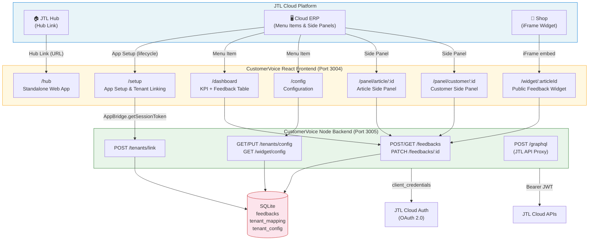

# CustomerVoice – JTL PaCon 2026 Demo

> Demo app for the guided workshop / hackathon at the JTL Partner Conference 2026.
> Shows how partners can build apps for the JTL Cloud Platform using a fictional customer feedback app.

## Goal

CustomerVoice demonstrates all relevant integration points of the JTL Cloud Platform in a single app:

- **App Setup** – tenant linking via AppBridge on first installation
- **Hub Link** – entry point from the JTL Hub directly into the web app
- **ERP Menu Items** – custom navigation entries (Dashboard & Configuration)
- **Context-aware Side Panels** – reacts to the currently open article or customer
- **Public Widget (iFrame)** – embeddable on shop article pages for feedback collection
- **Backend API Access** – authenticates via OAuth 2.0 and calls JTL Cloud APIs

## What does CustomerVoice do?

A lean multi-tenant feedback management solution:

- Customers submit feedback on articles (rating + comment)
- Merchants manage all feedback centrally in the dashboard
- In the Cloud ERP, merchants see contextual feedback for the current article or customer
- Status workflow for processing (open / in progress / solved)

## Architecture



## Tech Stack

| Layer      | Technology                                    |
|------------|-----------------------------------------------|
| Frontend   | React + Vite                                  |
| Backend    | Node.js + Express                             |
| Database   | SQLite (`better-sqlite3`)                     |
| Auth       | OAuth 2.0 client_credentials (JTL Cloud Auth) |
| Deployment | Local via Node – no Docker required           |

Intentionally simple: no Docker Compose needed, SQLite as a file – partners are up and running within minutes.

## Data Model

```sql
-- Feedback entries (core of the app)
CREATE TABLE feedbacks (
  id          INTEGER PRIMARY KEY AUTOINCREMENT,
  tenant_id   TEXT    NOT NULL,
  customer_id TEXT    NOT NULL DEFAULT '',
  article_id  TEXT    NOT NULL DEFAULT '',
  rating      INTEGER NOT NULL CHECK(rating BETWEEN 1 AND 5),
  comment     TEXT,
  status      TEXT    NOT NULL DEFAULT 'open' CHECK(status IN ('open', 'in-progress', 'solved')),
  created_at  DATETIME DEFAULT CURRENT_TIMESTAMP
);

-- Maps CustomerVoice tenant IDs to JTL tenant IDs
CREATE TABLE tenant_mapping (
  id            INTEGER PRIMARY KEY AUTOINCREMENT,
  tenant_id     TEXT NOT NULL UNIQUE,   -- cv-<jtl-tenant-id>
  jtl_tenant_id TEXT NOT NULL UNIQUE,
  created_at    DATETIME DEFAULT CURRENT_TIMESTAMP
);

-- Per-tenant shop settings
CREATE TABLE tenant_config (
  tenant_id     TEXT PRIMARY KEY,
  shop_name     TEXT NOT NULL DEFAULT '',
  contact_email TEXT NOT NULL DEFAULT '',
  greeting_text TEXT NOT NULL DEFAULT ''
);
```

## API Endpoints

| Method | Path                        | Purpose                                                  |
|--------|-----------------------------|----------------------------------------------------------|
| POST   | `/tenants/link`             | Link JTL Cloud tenant (session token → tenant ID)        |
| GET    | `/feedbacks`                | List feedbacks (filter: `customer_id` / `article_id`)    |
| POST   | `/feedbacks`                | Submit new feedback (from widget)                        |
| PATCH  | `/feedbacks/:id`            | Update status (`open` / `in-progress` / `solved`)        |
| GET    | `/tenants/config`           | Read shop configuration                                  |
| PUT    | `/tenants/config`           | Save shop configuration                                  |
| GET    | `/widget/config?tenant=...` | Widget configuration (public, no auth required)          |
| POST   | `/graphql`                  | Proxy: JTL Cloud GraphQL API                             |

### Authentication

`GET /feedbacks` and all `/tenants/*` routes accept either:
- `X-Session-Token: <JTL Session Token>` – verified and resolved to the internal tenant ID, or
- `X-Tenant-ID: <cv-tenant-id>` – direct access (for local testing without AppBridge)

The backend service authenticates itself using OAuth 2.0 client_credentials against `https://auth.jtl-cloud.com/oauth2/token` (credentials in `.env`).

### Tenant Linking

During app setup, the setup page calls `getSessionToken` via AppBridge and sends the token to `POST /tenants/link`. The backend verifies the token via JWKs (`https://api.jtl-cloud.com/account/.well-known/jwks.json`) and stores the mapping `cv-<jtl-tenant-id>` ↔ JTL tenant ID in the database.

## Frontend Routes

| Route                 | Purpose                                                              |
|-----------------------|----------------------------------------------------------------------|
| `/setup`              | App setup & tenant linking (AppBridge required)                      |
| `/hub`                | Standalone web app (opened from JTL Hub, no AppBridge)              |
| `/dashboard`          | KPI cards (open, in progress, solved, avg. rating) + feedback table  |
| `/config`             | Configuration (shop name, contact email, greeting text, widget URL)  |
| `/panel/article/:id`  | Side panel: feedbacks for the current article                        |
| `/panel/customer/:id` | Side panel: feedbacks for the current customer                       |
| `/widget/:articleId`  | Public feedback widget (iFrame on shop article page)                 |

### Widget URL (Shop Integration)

```
/widget/ARTICLE-ID?tenant=cv-<jtl-tenant-id>&customer=CUSTOMER-ID
```

`ARTICLE-ID` – article or product ID from the shop  
`CUSTOMER-ID` – ID of the logged-in customer submitting the feedback  
The tenant ID is shown on the configuration page in the ERP.

### Demo Modes (Query Parameters)

Some pages support a demo mode that works without a running JTL platform:

| URL                              | Shows                                                          |
|----------------------------------|----------------------------------------------------------------|
| `/setup?dummy-pairing-flow=true` | Simulated login flow (CustomerVoice login → tenant confirmation) |
| `/hub?dummy-standalone=true`     | Full standalone app (Dashboard + Settings) with dummy data     |

## Quick Start

```bash
# Clone the repo
git clone <repo-url>
cd jtl-platform-demo-pacon-2026/customer-voice

# Install dependencies
npm install

# Set up backend credentials (CLIENT_ID + CLIENT_SECRET from the Partner Portal)
cp packages/backend/.env.example packages/backend/.env
# Open .env and fill in CLIENT_ID and CLIENT_SECRET

# Start backend (port 3005)
npm run dev --workspace=packages/backend

# Start frontend (port 3004)
npm run dev --workspace=packages/frontend
```

Frontend: http://localhost:3004  
Backend: http://localhost:3005

The backend starts without a filled-in `.env` – but all JTL API calls will fail. Feedback features (widget, dashboard, panels) work independently.

## Workshop Outline

1. **Setup** – clone repo, install dependencies, start the app
2. **App Registration** – register app in the JTL Developer Portal, deploy manifest
3. **Tenant Linking** – run the setup flow via AppBridge (`/setup`)
4. **Hub Link** – open standalone web app from the JTL Hub (`/hub`)
5. **ERP Menu Items** – embed Dashboard & Configuration
6. **Context Panels** – side panels for article & customer
7. **Shop Widget** – embed iFrame on the article page
8. **API Access** – query JTL Cloud GraphQL API from the backend

## Note

This app is a demo for educational purposes at JTL PaCon 2026. It is intentionally minimal to clearly illustrate the integration points of the JTL Cloud Platform — not intended as a production-ready solution.
